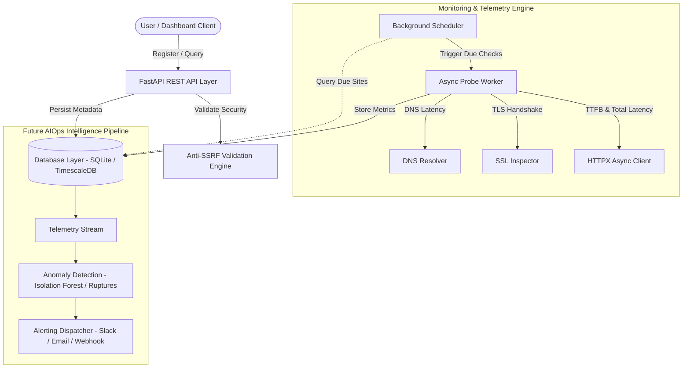

# AIOps – Website Monitoring & Anomaly Detection Platform

[](https://www.python.org/)
[](https://fastapi.tiangolo.com/)
[](LICENSE)
[](https://www.docker.com/)

An intelligent, production-grade universal website monitoring and anomaly detection platform. Monitors any publicly accessible web service—whether deployed on **Vercel, AWS, Netlify, Render, DigitalOcean, Cloudflare, or custom infrastructure**—capturing fine-grained performance telemetry, tracking uptime, and preparing time-series metrics for machine learning anomaly detection.

---

## 1. Project Overview & Objectives

Traditional ping checks only report binary up/down status without revealing subtle performance degradation, DNS latency spikes, or impending SSL certificate expirations. The **AIOps Website Monitoring Platform** solves this by combining asynchronous active probing, anti-SSRF security boundaries, persistent telemetry collection, and background scheduling.

### Key Capabilities

1. **Universal Hosting Support:** Monitor websites on Vercel, Netlify, AWS, Render, DigitalOcean, VPS, or bare-metal servers.
2. **Deep Telemetry Collection (Phase 2 Probing Engine):**
   - **Multi-Phase Probing:** 4-stage pipeline: (1) URL/SSRF Security Validation, (2) DNS Resolution, (3) TLS Handshake Inspection, (4) HTTP Streaming Telemetry.
   - **Isolated Timing Metrics:**
     - DNS Lookup Duration (`dns_lookup_ms` via `dnspython`)
     - TCP Connection Duration (`tcp_connect_ms`)
     - TLS Handshake Duration (`tls_handshake_ms` via `loop.start_tls` and `truststore`)
     - Time to First Byte (`ttfb_ms` via HTTPX streaming headers)
     - Content Download Duration (`download_ms`)
     - Total Request Duration (`total_time_ms`)
   - **Availability Determination:**
     - HTTP 2xx/3xx: `UP` (`is_success=True`)
     - HTTP 4xx: `UP` (`is_success=False`, client-side error)
     - HTTP 5xx: `DOWN` (`is_success=False`, server fault)
     - Timeouts / DNS Failures / Connection Refusals: `DOWN` (`is_success=False`)
   - **SSL/TLS Certificate Inspection:** Certificate validity, expiration date, and remaining days.
   - **Payload Size & Redirects:** Safe redirect following with per-hop SSRF validation, hop count, and response size guards.
   - **No Fabricated Data:** Unperformed or failed phases cleanly record `None` rather than fake values.
3. **Strict Network & Anti-SSRF Security:**
   - Prohibits private/link-local/loopback IP addresses (`127.0.0.0/8`, `10.0.0.0/8`, `172.16.0.0/12`, `192.168.0.0/16`, `::1`).
   - Blocks cloud metadata endpoints (`169.254.169.254`, `169.254.170.2`, `fd00:ec2::254`).
   - Prevents DNS rebinding by validating all resolved IP addresses before probing and passing pre-resolved IPs.
   - Enforces allowed schemes (`http`, `https`) and standard web ports (`80`, `443`, `8080`, `8443`).
   - Enforces minimum monitoring interval of 60 seconds.
4. **Asynchronous Background Scheduling:**
   - Powered by `APScheduler` (`AsyncIOScheduler`) with non-blocking execution.
   - Concurrency limits enforced via `asyncio.Semaphore` (configurable).
   - Overlap guard prevents duplicate concurrent probes for the same website.
5. **Dual Database Architecture & SQLAlchemy ORM:**
   - SQLAlchemy 2.0 declarative models (`Website`, `MonitoringResult`) with cascading deletes.
   - SQLite for local development and integration tests; PostgreSQL / TimescaleDB ready for production time-series scale.

---

## 2. Architecture



---

## 3. Technology Stack

- **Runtime & Language:** Python 3.10+ (tested on Python 3.12)
- **Web API Framework:** [FastAPI](https://fastapi.tiangolo.com/) + [Uvicorn](https://www.uvicorn.org/)
- **HTTP Client:** [HTTPX](https://www.python-httpx.org/) (Asynchronous, HTTP/1.1 and HTTP/2)
- **DNS & Cryptography:** `dnspython`, `cryptography`
- **Scheduler:** `APScheduler` (Background periodic execution)
- **Database & ORM:** SQLite3 (dev), `SQLAlchemy` 2.0, `psycopg2-binary` (PostgreSQL / TimescaleDB)
- **Data & Machine Learning:** `pandas`, `numpy`, `scikit-learn`, `statsmodels`, `ruptures`, `mlflow`
- **Containerization:** Docker, Docker Compose
- **Testing:** `pytest`, `pytest-asyncio`

---

## 4. Project Structure

```text
AIOps-Cloud-Infrastructure-Anomaly-Detection/
│
├── api/                               # REST API layer
│   ├── __init__.py
│   └── app.py                         # FastAPI routes, middleware, lifespan
│
├── monitoring/                        # Core probing and security engines
│   ├── __init__.py
│   ├── timing.py                      # Monotonic clock instrumentation
│   ├── security.py                    # Anti-SSRF, DNS resolution, port validation
│   ├── url_validator.py               # Security validation shim
│   ├── dns_checker.py                 # Async DNS resolver with dnspython
│   ├── ssl_checker.py                 # Async TLS handshake & cert inspection
│   ├── http_checker.py                # HTTPX streaming telemetry probe
│   ├── probe_engine.py                # 4-Phase orchestrator (ProbeResult)
│   └── engine.py                      # Backward-compatibility engine
│
├── database/                          # Persistence layer
│   ├── __init__.py
│   ├── db.py                          # SQLite schema initialization and legacy queries
│   ├── models.py                      # SQLAlchemy 2.0 declarative models (Website, MonitoringResult)
│   └── repository.py                  # MonitoringRepository CRUD and aggregation layer
│
├── services/                          # Domain business logic
│   ├── __init__.py
│   └── website_service.py             # Website registration, probe orchestration
│
├── scheduler/                         # Background job runner
│   ├── __init__.py
│   └── monitor_scheduler.py           # APScheduler periodic runner with concurrency & overlap guard
│
├── models/                            # Data contracts and schemas
│   ├── __init__.py
│   └── schemas.py                     # Pydantic v2 request/response schemas
│
├── config/                            # Structured configuration & logging
│   ├── __init__.py
│   ├── settings.py                    # Environment settings
│   └── logging_config.py              # Structured JSON / console logger
│
├── anomaly_detection/                 # Machine learning anomaly detection (Phase 3)
│   └── __init__.py
│
├── alerting/                          # Alerting and webhook dispatchers (Phase 4)
│   └── __init__.py
│
├── tests/                             # Automated test suite (153 tests)
│   ├── __init__.py
│   ├── test_setup.py                  # Environment and directory structure tests
│   ├── test_security.py               # Anti-SSRF boundary tests
│   ├── test_url_validator.py          # Strict URL validation and SSRF tests
│   ├── test_dns_checker.py            # DNS checker tests
│   ├── test_ssl_checker.py            # SSL inspection and cert parsing tests
│   ├── test_http_checker.py           # HTTP checker and streaming telemetry tests
│   ├── test_probe_engine.py           # 4-phase probe engine pipeline tests
│   ├── test_monitoring_repository.py  # SQLAlchemy repository and FK cascade tests
│   ├── test_monitoring_engine.py      # HTTP/DNS/SSL probe unit tests
│   ├── test_database.py               # SQLite persistence and query tests
│   ├── test_api.py                    # FastAPI endpoint integration tests
│   └── test_scheduler.py              # APScheduler interval, concurrency, and lifecycle tests
│
├── data/                              # Local database and persistent storage
├── config.py                          # Centralized environment configuration
├── main.py                            # CLI entry-point and server launcher
├── requirements.txt                   # Locked project dependencies
├── Dockerfile                         # Container definition
├── docker-compose.yml                 # Multi-container stack (API, TimescaleDB, Grafana)
├── .dockerignore                      # Docker build exclusions
├── .env.example                       # Environment configuration template
├── pytest.ini                         # Pytest configuration
└── README.md                          # Documentation
```

---

## 5. Getting Started

### Local Setup (Virtual Environment)

1. **Clone the repository and enter directory:**
   ```bash
   git clone <repo-url>
   cd AIOps-Cloud-Infrastructure-Anomaly-Detection
   ```

2. **Create and activate a Python 3.12 virtual environment:**
   ```bash
   python -m venv venv
   # Windows PowerShell:
   .\venv\Scripts\Activate.ps1
   # Linux/macOS:
   source venv/bin/activate
   ```

3. **Install dependencies:**
   ```bash
   pip install -r requirements.txt
   ```

4. **Initialize database and check environment:**
   ```bash
   python main.py
   ```

5. **Start the API server and background scheduler:**
   ```bash
   python main.py --serve
   # Or using uvicorn directly:
   uvicorn api.app:app --host 127.0.0.1 --port 8000 --reload
   ```

6. **Access Interactive API Documentation:**
   - Swagger UI: [http://127.0.0.1:8000/docs](http://127.0.0.1:8000/docs)
   - ReDoc: [http://127.0.0.1:8000/redoc](http://127.0.0.1:8000/redoc)

---

### Docker & Docker Compose Setup

Run the full stack (FastAPI API, TimescaleDB, Grafana) with a single command:

```bash
docker compose up -d --build
```

- **API:** `http://localhost:8000`
- **TimescaleDB:** `localhost:5432`
- **Grafana:** `http://localhost:3000` (User: `admin`, Pass: `admin`)

---

## 6. REST API Reference

| Method | Endpoint | Description |
|---|---|---|
| `GET` | `/health` | Service health status |
| `POST` | `/api/v1/websites` | Register a new website for continuous monitoring |
| `GET` | `/api/v1/websites` | List all registered websites and latest check status |
| `GET` | `/api/v1/websites/{id}` | Get website metadata and aggregated performance statistics |
| `PATCH` | `/api/v1/websites/{id}` | Update monitoring interval, name, or active status |
| `DELETE` | `/api/v1/websites/{id}` | Delete website and historical metrics |
| `POST` | `/api/v1/websites/{id}/check` | Trigger an immediate on-demand probe |
| `GET` | `/api/v1/websites/{id}/metrics` | Retrieve time-series historical telemetry data |
| `GET` | `/api/v1/websites/{id}/stats` | Get aggregate uptime percentage, average TTFB, and latency |

### Example: Register a Website

```bash
curl -X POST "http://127.0.0.1:8000/api/v1/websites" \
     -H "Content-Type: application/json" \
     -d '{"url": "https://example.com", "name": "Example Prod", "check_interval": 60}'
```

### Example Response:

```json
{
  "id": 1,
  "url": "https://example.com/",
  "name": "Example Prod",
  "check_interval": 60,
  "is_active": true,
  "created_at": "2026-03-01T12:00:00Z",
  "latest_check": {
    "is_up": true,
    "status": "UP",
    "http_status_code": 200,
    "response_time_ms": 45.2,
    "ttfb_ms": 28.1,
    "dns_time_ms": 8.4,
    "ssl_valid": true,
    "ssl_days_remaining": 280,
    "response_size_bytes": 1256,
    "redirect_count": 0
  }
}
```

---

## 7. Running the Test Suite

Execute the test suite with coverage and verbose reporting:

```bash
pytest -v
```

The test suite validates:
- Project directories and required dependencies (`test_setup.py`)
- Anti-SSRF boundary enforcement and URL normalization (`test_security.py`)
- Real-time HTTP/DNS/SSL probe behavior and error classification (`test_monitoring_engine.py`)
- SQLite persistence, hypertable queries, and uptime aggregations (`test_database.py`)
- FastAPI endpoints, error handling, and status codes (`test_api.py`)
- Scheduler due-time interval evaluation and dispatching (`test_scheduler.py`)

---

## 8. License

This project is licensed under the MIT License - see the [LICENSE](LICENSE) file for details.
