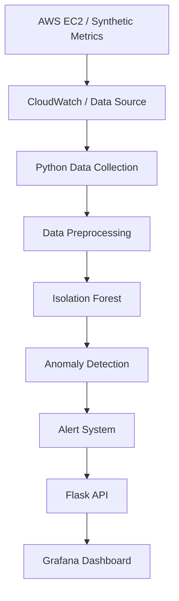

# AIOps – Cloud Infrastructure Anomaly Detection

## Project Overview

**AIOps – Cloud Infrastructure Anomaly Detection** is an automated intelligence platform designed to monitor cloud computing environments, detect abnormal behavioral patterns across server telemetry, and notify operations teams before service degradation occurs.

Modern cloud deployments generate massive volumes of metric telemetry across thousands of compute nodes. Traditional rule-based threshold alerting frequently causes alert fatigue or misses subtle, multi-variate deviations. This system leverages unsupervised Machine Learning (**Isolation Forest**) to evaluate multidimensional metric streams—identifying complex anomalies across compute, memory, storage, and networking layers without requiring labeled incident historical data.

---

## Objectives

- **Monitor Infrastructure Metrics:** Collect and track time-series metrics from cloud infrastructure (e.g., AWS EC2, CloudWatch).
- **Detect Unusual CPU Utilization:** Uncover unexpected processor spikes, anomalous idle patterns, or crypto-mining signatures.
- **Identify Memory Anomalies:** Pinpoint rapid memory leaks and sudden allocation exhaustion.
- **Monitor Disk Utilization:** Identify abnormal read/write throughput surges and storage saturation.
- **Detect Abnormal Network Traffic:** Spot traffic anomalies, outbound data exfiltration indicators, or DDoS packet floods.
- **Generate Infrastructure Alerts:** Trigger actionable alerts categorized by anomaly severity score.
- **Visualize System Health:** Expose metrics and detected anomalies through a Flask REST API connected to Grafana dashboards.

---

## Planned Technologies

- **Programming Language:** Python 3.10+ (tested with Python 3.12)
- **Data Engineering:** Pandas, NumPy
- **Machine Learning:** Scikit-learn (Isolation Forest), SciPy, Joblib
- **Visualization & Profiling:** Matplotlib, Seaborn, Jupyter Notebook
- **Cloud Infrastructure & Telemetry:** AWS EC2, AWS CloudWatch, Boto3
- **API & Dashboarding:** Flask, Flask-CORS, Grafana
- **Testing & Code Quality:** Pytest, Flake8, Black

---

## Project Architecture

The diagram below illustrates the planned end-to-end architecture:



> **Note:** The architecture above represents the end-to-end target design. Current implementation status: **Phase 1 (Environment Setup)** and **Phase 2 (Infrastructure Dataset Generation)** are completed.

---

## Project Structure

```text
AIOps-Cloud-Infrastructure-Anomaly-Detection/
│
├── data/
│   ├── raw/                           # Ingested raw telemetry and metric files
│   │   ├── infrastructure_metrics.csv        # Full 10,000-row synthetic dataset
│   │   ├── infrastructure_metrics_sample.csv # 100-row quick inspection sample
│   │   └── dataset_summary.txt               # Statistical & distributional summary
│   │
│   ├── processed/                     # Cleaned, normalized, and feature-engineered datasets
│   │
│   └── visualizations/                # High-resolution exploratory analysis charts
│       ├── cpu_usage.png
│       ├── memory_usage.png
│       ├── disk_usage.png
│       ├── network_in.png
│       ├── network_out.png
│       ├── request_count.png
│       ├── response_time.png
│       ├── anomaly_distribution.png
│       ├── anomaly_type_distribution.png
│       └── correlation_heatmap.png
│
├── notebooks/
│   └── exploratory_analysis.ipynb     # Interactive EDA notebook with verified outputs
│
├── src/                               # Core application package
│   ├── __init__.py
│   ├── data_generator.py              # Synthetic telemetry & anomaly injection engine
│   ├── data_validation.py             # 16-point automated data validation suite
│   ├── data_collection.py             # Ingestion interface & telemetry helpers
│   ├── preprocessing.py               # Phase 3 placeholder (scaling & features)
│   ├── anomaly_detection.py           # Phase 4 placeholder (Isolation Forest)
│   ├── alert_system.py                # Phase 5 placeholder (alert dispatch)
│   └── evaluation.py                  # Phase 4/8 placeholder (evaluation metrics)
│
├── scripts/
│   └── generate_dataset.py            # CLI pipeline to generate, validate, and plot
│
├── api/                               # REST API serving telemetry and anomaly feeds
│   ├── __init__.py
│   └── app.py
│
├── dashboard/                         # Grafana dashboards and provisioning assets
├── models/                            # Serialized model weights and scalers
│
├── tests/                             # Unit and integration test suite
│   ├── __init__.py
│   ├── test_setup.py                  # Phase 1 setup verification
│   ├── test_data_generator.py         # Generation bounds, logic, & reproducibility tests
│   └── test_data_validation.py        # Validation engine error-detection tests
│
├── config.py                          # Centralized configuration and path management
├── main.py                            # Initial execution entry-point
├── requirements.txt                   # Reproducible project dependencies
├── .gitignore                         # Comprehensive Git exclusions
├── .env.example                       # Environment variables template
├── .flake8                            # Code style configuration (Black + Flake8)
├── README.md                          # Project documentation
└── LICENSE                            # MIT License
```

---

## Phase 2: Synthetic Telemetry Generation & Analysis

### Why Synthetic Infrastructure Data?
In real-world cloud environments, production failures, severe memory leaks, and distributed denial-of-service attacks are rare, uncoordinated events. Collecting labeled production incident data often requires months of waiting or dangerous production fault injection. 

For Phase 2, we generate a high-fidelity synthetic cloud infrastructure dataset simulating an **AWS EC2 compute instance** (`i-0f8b3c4a2d1e98765`) over **10,000 continuous minutes** (~6.94 days). This provides:
1. **Ground-Truth Calibration:** Exact knowledge of anomaly onset, duration, and failure type to evaluate machine learning models rigorously.
2. **Realistic Metric Interdependencies:** Normal workload cycles where request volume drives CPU and network usage, and server load affects latency.
3. **Controlled Contamination:** Precisely calibrated 5.0% anomaly rate across 6 distinct failure scenarios.

> **Important:** This dataset is simulated infrastructure telemetry designed for ML benchmarking; live AWS CloudWatch ingestion is introduced in Phase 6.

### Dataset Schema & Metric Definitions
The dataset is persisted to `data/raw/infrastructure_metrics.csv` with the following 11 columns:

| Column | Data Type | Units / Range | Description |
|---|---|---|---|
| `timestamp` | String (ISO) | YYYY-MM-DD HH:MM:SS | Date and time of observation (1-minute intervals) |
| `instance_id` | String | String | Simulated AWS EC2 instance identifier (`i-0f8b3c4a2d1e98765`) |
| `cpu_usage` | Float64 | 0.0% – 100.0% | Percentage CPU processor utilization |
| `memory_usage` | Float64 | 0.0% – 100.0% | Percentage RAM occupancy |
| `disk_usage` | Float64 | 0.0% – 100.0% | Percentage root storage volume occupancy |
| `network_in` | Float64 | Mbps (≥ 0.0) | Inbound network traffic throughput |
| `network_out` | Float64 | Mbps (≥ 0.0) | Outbound network traffic throughput |
| `request_count` | Int64 | Requests/min (≥ 0) | Incoming application HTTP/API request volume |
| `response_time` | Float64 | Milliseconds (> 0.0) | Application response latency |
| `anomaly_label` | Int64 | 0 or 1 | Ground truth indicator (0 = Normal, 1 = Anomaly) |
| `anomaly_type` | String | Categorical | Specific failure mode or `'normal'` |

### Normal Behavior Simulation
Normal behavior is not a series of static numbers, but a dynamic, interconnected system:
- **Diurnal Cycles:** A 24-hour sinusoidal workload simulates peak afternoon traffic (14:00) and nocturnal lulls (03:00), with reduced activity on weekends.
- **Request Load:** Base rate of 160–420 req/min drives proportional CPU load and network packet volume.
- **CPU Utilization:** Runs between 18% and 60% normally, with random operational fluctuations.
- **Memory Stability:** An autoregressive AR(1) process with mean reversion around 48% and small variations.
- **Disk Drift:** Slow, continuous storage accumulation (~41.5% to 48.8%) simulating runtime logging and cache storage.
- **Response Time:** Normal baseline of 25–65 ms, sensitive to momentary CPU and request increases.

### Anomaly Scenarios & Precedence
The dataset injects 500 anomalous records (5.00% contamination) distributed across multi-minute incidents:
1. **`cpu_spike` (80 records, 2 incidents):** Sudden pegging at 91–100% CPU due to runaway processes, causing thread contention and elevated response times (190–360 ms).
2. **`memory_spike` (80 records, 2 incidents):** Rapid memory allocation reaching 91–99% occupancy, triggering swapping overhead and latency degradation.
3. **`disk_anomaly` (80 records, 2 incidents):** Storage volume surge reaching 92–99.5% capacity, causing I/O wait.
4. **`network_spike` (75 records, 2 incidents):** Inbound traffic surges (420–880 Mbps) and outbound floods (650–1380 Mbps) with 1,400–2,900 req/min, elevating CPU and network latency.
5. **`combined_anomaly` (85 records, 2 incidents):** Catastrophic simultaneous breakdown (CPU > 95%, RAM > 92%, network surge, latency exploding to 850–2400 ms).
6. **`gradual_degradation` (100 records, 1 continuous incident):** Unchecked memory leak where RAM climbs progressively from baseline to 96%, CPU rises to 86%, and response latency escalates exponentially from 45 ms to over 600 ms.

*Precedence Hierarchy:* If incident windows ever overlap, labels resolve deterministically:  
`combined_anomaly` > `gradual_degradation` > `cpu_spike` > `memory_spike` > `disk_anomaly` > `network_spike` > `normal`.

### Data Validation Engine
`src/data_validation.py` executes an automated **16-point integrity inspection** on every generated dataset:
- [x] Record count matches target (10,000)
- [x] All 11 required columns exist
- [x] Zero duplicate timestamps
- [x] Strictly monotonic increasing timestamps
- [x] Zero missing/null values across all columns
- [x] CPU usage bounded in [0, 100]
- [x] Memory usage bounded in [0, 100]
- [x] Disk usage bounded in [0, 100]
- [x] Network metrics (in/out) strictly non-negative
- [x] Request count non-negative integers
- [x] Response time strictly positive (> 0 ms)
- [x] Anomaly label strictly binary ({0, 1})
- [x] Anomaly type matches valid catalog
- [x] Label=0 strictly implies Type='normal'
- [x] Label=1 strictly implies Type!='normal'
- [x] Anomaly percentage within target tolerance (4.0% – 6.0%)

---

## Dataset Generation & CLI Usage

Regenerate the entire dataset, validate integrity, and re-render all exploratory charts using a single command:

```bash
# Using default parameters (10,000 records, seed 42)
python scripts/generate_dataset.py

# Optional: customize record count and seed
python scripts/generate_dataset.py --records 10000 --seed 42

# Optional: skip rendering visualization PNGs
python scripts/generate_dataset.py --skip-viz
```

---

## Installation & Setup Instructions

### 1. Prerequisites
- **Python**: Version 3.10 or newer (tested with Python 3.12).
- **Git**: Installed and available in your shell.

### 2. Clone the Repository & Navigate to Root
```bash
git clone <repository-url>
cd AIOps-Cloud-Infrastructure-Anomaly-Detection
```

### 3. Create a Virtual Environment
- **Windows (PowerShell / Command Prompt):**
  ```powershell
  python -m venv venv
  .\venv\Scripts\activate
  ```
- **Linux / macOS:**
  ```bash
  python3 -m venv venv
  source venv/bin/activate
  ```

### 4. Install Dependencies
```bash
pip install --upgrade pip
pip install -r requirements.txt
```

### 5. Configure Environment Variables
Copy the template configuration file to `.env`:
- **Windows:**
  ```powershell
  Copy-Item .env.example .env
  ```
- **Linux / macOS:**
  ```bash
  cp .env.example .env
  ```

### 6. Register the Jupyter Kernel
Register the project virtual environment with Jupyter:
```bash
python -m ipykernel install --user --name AIOps-Anomaly-Detection --display-name "Python (AIOps-Anomaly-Detection)"
```

### 7. Run Initialization & Verification Tests
```bash
# Run entry-point
python main.py

# Run all automated unit and integration tests (51 tests)
pytest -v

# Run code style and linting checks
flake8 src/ scripts/ tests/
```

### 8. Interactive Notebook Exploration
Open Jupyter Notebook and execute `notebooks/exploratory_analysis.ipynb`:
```bash
jupyter notebook notebooks/exploratory_analysis.ipynb
```

---

## Development Roadmap

The project is structured across eight organized phases:

1. **Phase 1: Project Initialization & Environment Setup** *(Completed)*: Folder structure, virtual environment, dependency management, baseline testing, and configuration.
2. **Phase 2: Infrastructure Dataset Generation** *(Completed)*: Simulation of realistic server metric streams (CPU, RAM, Disk, Network, Requests, Latency), 16-point validation suite, exploratory charts, and ground-truth labeling.
3. **Phase 3: Data Preprocessing & Exploratory Analysis**: Metric normalization, feature transformation, rolling aggregations, and EDA notebook.
4. **Phase 4: Isolation Forest Model Development**: Model training, contamination tuning, scoring anomaly thresholds, and serializing model artifacts.
5. **Phase 5: Alert System**: Real-time evaluation engine and severity-based alerting mechanism (Critical, High, Warning).
6. **Phase 6: AWS CloudWatch Integration**: Live ingestion pipeline querying CloudWatch metrics via Boto3.
7. **Phase 7: Flask API & Grafana Dashboard**: REST API endpoints for metric querying and Grafana live dashboard integration.
8. **Phase 8: Testing, Deployment & Documentation**: Automated end-to-end testing, Docker containerization, and production operations guide.

---

## License

This project is licensed under the [MIT License](LICENSE).
