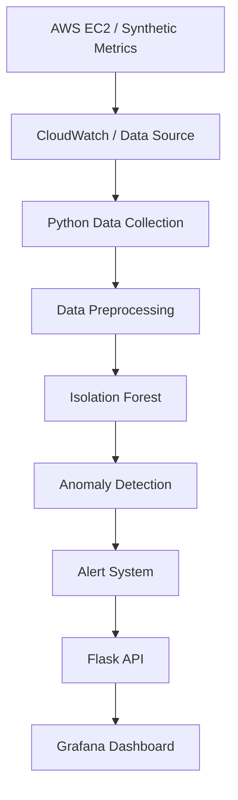

# AIOps – Cloud Infrastructure Anomaly Detection

## Project Overview

**AIOps – Cloud Infrastructure Anomaly Detection** is an automated intelligence platform designed to monitor cloud computing environments, detect abnormal behavioral patterns across server telemetry, and notify operations teams before service degradation occurs.

Modern cloud deployments generate massive volumes of metric telemetry across thousands of compute nodes. Traditional rule-based threshold alerting frequently causes alert fatigue or misses subtle, multi-variate deviations. This system leverages unsupervised Machine Learning (**Isolation Forest**) to evaluate multidimensional metric streams—identifying complex anomalies across compute, memory, storage, and networking layers without requiring labeled incident historical data.

---

## Objectives

- **Monitor Infrastructure Metrics:** Collect and track time-series metrics from cloud infrastructure (e.g., AWS EC2, CloudWatch).
- **Detect Unusual CPU Utilization:** Uncover unexpected processor spikes, anomalous idle patterns, or crypto-mining signatures.
- **Identify Memory Anomalies:** Pinpoint rapid memory leaks and sudden allocation exhaustion.
- **Monitor Disk Utilization:** Identify abnormal read/write throughput surges and storage saturation.
- **Detect Abnormal Network Traffic:** Spot traffic anomalies, outbound data exfiltration indicators, or DDoS packet floods.
- **Generate Infrastructure Alerts:** Trigger actionable alerts categorized by anomaly severity score.
- **Visualize System Health:** Expose metrics and detected anomalies through a Flask REST API connected to Grafana dashboards.

---

## Planned Technologies

- **Programming Language:** Python 3.10+
- **Data Engineering:** Pandas, NumPy
- **Machine Learning:** Scikit-learn (Isolation Forest), SciPy, Joblib
- **Visualization & Profiling:** Matplotlib, Seaborn, Jupyter Notebook
- **Cloud Infrastructure & Telemetry:** AWS EC2, AWS CloudWatch, Boto3
- **API & Dashboarding:** Flask, Flask-CORS, Grafana
- **Testing & Code Quality:** Pytest, Flake8, Black

---

## Project Architecture

The diagram below illustrates the planned end-to-end architecture:



> **Note:** The architecture above represents the end-to-end target design. Current implementation status is **Phase 1: Project Setup and Environment Initialization**.

---

## Project Structure

```text
AIOps-Cloud-Infrastructure-Anomaly-Detection/
│
├── data/
│   ├── raw/                  # Ingested raw telemetry and metric files
│   └── processed/            # Cleaned, normalized, and feature-engineered datasets
│
├── notebooks/
│   └── exploratory_analysis.ipynb  # Interactive data exploration & visualization
│
├── src/                      # Core application package
│   ├── __init__.py
│   ├── data_collection.py    # Metric ingestion and cloud extraction
│   ├── preprocessing.py      # Cleaning, scaling, and feature engineering
│   ├── anomaly_detection.py  # Isolation Forest training and scoring
│   ├── alert_system.py       # Notification and alerting dispatch
│   └── evaluation.py         # Performance validation and metrics calculation
│
├── api/                      # REST API serving telemetry and anomaly feeds
│   ├── __init__.py
│   └── app.py
│
├── dashboard/                # Grafana dashboards and provisioning assets
├── models/                   # Serialized model weights and scalers
│
├── tests/                    # Unit and integration test suite
│   ├── __init__.py
│   └── test_setup.py
│
├── config.py                 # Centralized configuration and path management
├── main.py                   # Initial execution entry-point
├── requirements.txt          # Reproducible project dependencies
├── .gitignore                # Git exclusions
├── .env.example              # Environment variables template
├── README.md                 # Project documentation
└── LICENSE                   # MIT License
```

---

## Installation & Setup Instructions

### 1. Prerequisites
- **Python**: Version 3.10 or newer (tested with Python 3.12).
- **Git**: Installed and available in your shell.

### 2. Clone the Repository & Navigate to Root
```bash
git clone <repository-url>
cd AIOps-Cloud-Infrastructure-Anomaly-Detection
```

### 3. Create a Virtual Environment
- **Windows (PowerShell / Command Prompt):**
  ```powershell
  python -m venv venv
  .\venv\Scripts\activate
  ```
- **Linux / macOS:**
  ```bash
  python3 -m venv venv
  source venv/bin/activate
  ```

### 4. Install Dependencies
Ensure the virtual environment is activated, then install all dependencies:
```bash
pip install --upgrade pip
pip install -r requirements.txt
```

### 5. Configure Environment Variables
Copy the template configuration file to `.env`:
- **Windows:**
  ```powershell
  Copy-Item .env.example .env
  ```
- **Linux / macOS:**
  ```bash
  cp .env.example .env
  ```
> **Security Notice:** Never commit `.env` containing sensitive credentials to source control. For production AWS workloads, prefer IAM Roles / instance profiles.

### 6. Register the Jupyter Kernel
Register the project virtual environment with Jupyter:
```bash
python -m ipykernel install --user --name AIOps-Anomaly-Detection --display-name "Python (AIOps-Anomaly-Detection)"
```

### 7. Run the Project
Execute `main.py` to confirm initialization:
```bash
python main.py
```

### 8. Run Verification Tests
Run the test suite using `pytest`:
```bash
pytest -v
```

---

## Development Roadmap

The project is structured across eight organized phases:

1. **Phase 1: Project Initialization & Environment Setup** *(Completed)*: Folder structure, virtual environment, dependency management, baseline testing, and configuration.
2. **Phase 2: Infrastructure Dataset Generation**: Simulation of realistic server metric streams (CPU, RAM, Disk I/O, Network) with injected anomaly scenarios.
3. **Phase 3: Data Preprocessing & Exploratory Analysis**: Metric normalization, feature transformation, rolling aggregations, and EDA notebook.
4. **Phase 4: Isolation Forest Model Development**: Model training, contamination tuning, scoring anomaly thresholds, and serializing model artifacts.
5. **Phase 5: Alert System**: Real-time evaluation engine and severity-based alerting mechanism (Critical, High, Warning).
6. **Phase 6: AWS CloudWatch Integration**: Live ingestion pipeline querying CloudWatch metrics via Boto3.
7. **Phase 7: Flask API & Grafana Dashboard**: REST API endpoints for metric querying and Grafana live dashboard integration.
8. **Phase 8: Testing, Deployment & Documentation**: Automated end-to-end testing, Docker containerization, and production operations guide.

---

## License

This project is licensed under the [MIT License](LICENSE).

